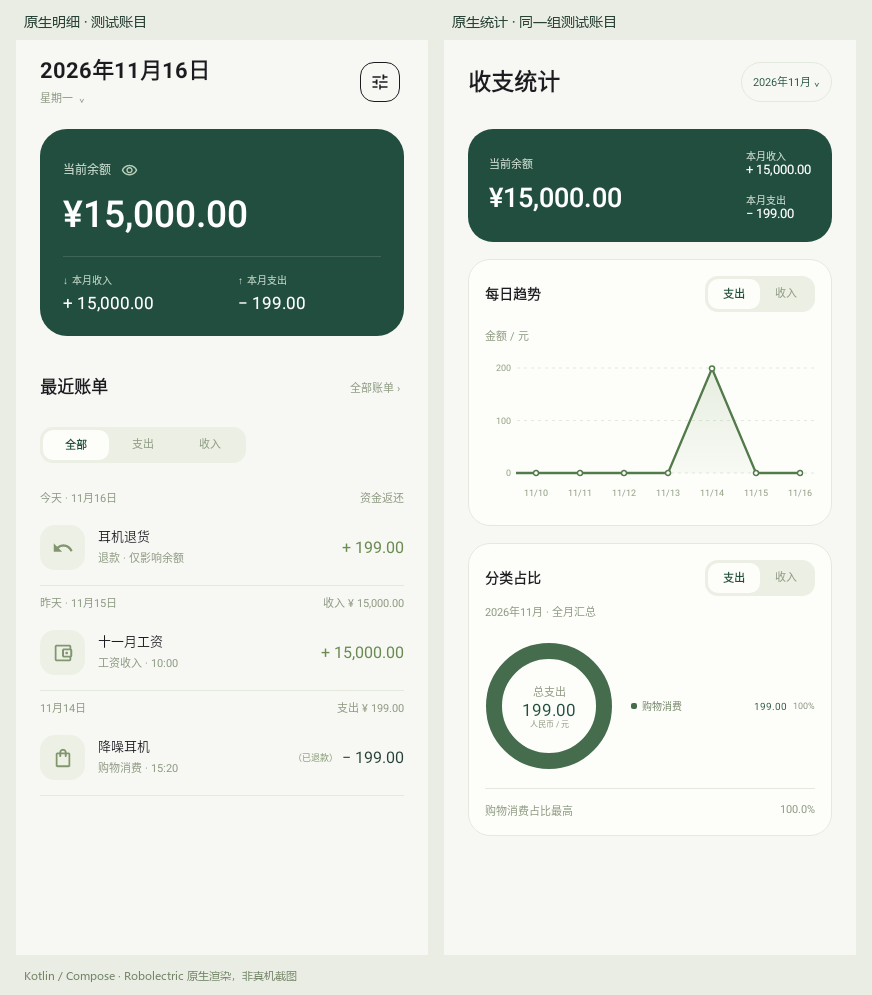

<p align="center">
  
</p>

<h1 align="center">余白 · Yubai Ledger</h1>

<p align="center">简洁、离线、可备份的 Android 记账应用</p>

<p align="center">
  <a href="https://github.com/Cottins-Vanilla/Yubai-Ledger/releases/latest"></a>
  <a href="https://github.com/Cottins-Vanilla/Yubai-Ledger/actions/workflows/android.yml"></a>
  
  
  
  <a href="LICENSE"></a>
</p>

<p align="center">
  <a href="https://github.com/Cottins-Vanilla/Yubai-Ledger/releases/latest">下载 APK</a> ·
  <a href="#安装">快速开始</a> ·
  <a href="#功能">功能</a> ·
  <a href="#界面预览">界面预览</a> ·
  <a href="docs/BUILD.md">开发文档</a> ·
  <a href="https://github.com/Cottins-Vanilla/Yubai-Ledger/issues/new/choose">反馈问题</a>
</p>

**余白（Yubai Ledger）** 使用 **Kotlin + Jetpack Compose + Room** 构建，以本地账本为核心，提供清晰收支、退款关联与自主备份。由 **Clottins Vanilla** 设计维护，采用 **MIT License**。

> 无需注册 · 本地存储 · 整数金额 · 原生 Android 界面

<details>
<summary>文档导航</summary>

- [安装与使用](#安装)
- [功能概览](#功能)
- [金额和退款口径](ACCOUNTING.md)
- [备份与恢复](BACKUP.md)
- [数据格式](docs/DATA_FORMAT.md)
- [构建与签名](docs/BUILD.md)
- [架构说明](docs/ARCHITECTURE.md)
- [验证记录](docs/TESTING.md)
- [性能与高刷新率](docs/PERFORMANCE.md)
- [参与贡献](CONTRIBUTING.md)
- [更新记录](CHANGELOG.md)

</details>

## 界面预览



以上为 Compose 原生代码的 JVM Android 渲染；测试示例不写入 Release 新安装账本。

[查看完整应用页面及新版紧凑导航](docs/screenshots/native-app-home.png)。底部导航主体为 60dp，中间记账按钮轻微上浮，并保留独立的系统安全区域。

## 使用要求

- Android 8.0（API 26）及以上。
- 无需注册，默认账本为空；截图中的账目均为演示数据。
- 不申请联网、通讯录或整个存储空间权限。备份与导入通过 Android 系统文件选择器完成。
- 账目保存在应用私有数据库；卸载会清除本机数据，换机或卸载前请导出 JSON 完整备份。

## 功能

- **明细**：当前余额、本月收入和支出、按日期排列的历史账单，以及收入/支出筛选。点击顶部日期可查看其他月份。
- **记一笔**：收支切换、分类、数字键盘、日期、备注，支持编辑原记录和删除确认。
- **统计**：原生横向滚动的每日收支折线、点选金额、分类环形饼图、分类金额与占比；没有数据时显示空状态。
- **退款**：独立类型，只增加余额，不进入收入、支出、折线和分类占比；可关联一笔原支出，支持多次部分退款与全额标记。
- **备份与导出**：JSON 完整备份、全部或日期范围 CSV 导出、JSON/标准 CSV 导入预览、相同 ID 去重、冲突阻止及完整替换恢复。
- **期初余额**：可填正数或负数，仅调整余额；余额可隐藏。
- **高刷新率适配**：请求设备支持的最高、不超过 144Hz 的刷新率，使用 Compose 帧同步和原生滚动。具体帧率受设备与系统控制，详见 [性能说明](docs/PERFORMANCE.md)。

## 金额与退款

金额以 `Long` 整数分存储，不用浮点数记账。

```text
当前余额 = 期初余额 + 历史普通收入 − 历史支出 + 历史退款
本月收入 = 本月普通收入（不含退款）
本月支出 = 本月原始支出（退款后不冲减）
净收支   = 普通收入 − 原始支出
```

“收入”是用户录入的到账金额，不自动推算税前工资、税费或成本。例如收入 1,000 元、支出 200 元、退款 50 元：收入仍为 1,000，支出仍为 200，期初为零时余额为 850。

收入分类中的“理财”已替换为“生活费”。退款入口放在收入分类区域便于查找，底层仍保存为独立的 `refund` 类型。

退款关联后，原支出显示“（部分退款）”或“（已退款）”。累计退款不能超过原支出；退款日期不能早于原支出。有退款关联的原支出不能直接删除；先解除关联或删除对应退款，避免失去账目来源。

## 安装

1. 在 [Releases](https://github.com/Cottins-Vanilla/Yubai-Ledger/releases) 下载 `Yubai-Ledger-v1.0.3.apk`。
2. 如系统询问，允许当前下载应用安装未知来源软件，再安装 APK。
3. 安装后桌面名称为“余白”，图标为 B「轻盈钱包」。从“设置 → 期初余额”录入现有余额，然后开始记账。

后续同包名、同签名 APK 可覆盖升级。自行编译的 Debug 版与公开 Release 版签名不同，切换前先导出备份；不能直接覆盖安装时，不要在未备份前卸载。

## 备份与恢复

“设置 → 完整备份”生成 JSON，保留账目、退款关联、分类、期初余额和余额隐藏设置。CSV 主要用于表格整理，不包含完整设置。

导入先显示条数、收支/退款金额、重复与冲突信息。默认合并并保留当前期初余额；相同 ID 且内容相同会跳过，内容冲突则整次阻止。内容相似但 ID 不同的记录不会擅自删除，预览会提示可能重复。

JSON 可选“完整恢复，替换本地账本”，需要再次确认。替换前自动保留一份应用内恢复前备份，可从设置导出；它也会随卸载删除。所有数据库修改使用 Room 事务，失败回滚。

限制：导入文件不超过 10 MB；账本最多 20,000 笔；单笔最多 999,999,999.99 元；备注最多 1,000 字符。标准 CSV 支持本应用格式，尚无其他记账软件的任意列自动映射。关联原账单缺失、超额退款、非法金额/日期或冲突必须先修正，不能跳过错误行后悄悄部分导入。

详细格式见 [备份说明](BACKUP.md) 和 [数据格式](docs/DATA_FORMAT.md)。

## 构建

需要 JDK 17、Android SDK 35。项目包含固定版本的 Gradle Wrapper：

```powershell
.\gradlew.bat :app:testDebugUnitTest :app:lintDebug :app:assembleDebug
```

```bash
./gradlew :app:testDebugUnitTest :app:lintDebug :app:assembleDebug
```

Android Studio 可直接打开根目录。无需安装 Kotlin 或 Gradle 到系统；Wrapper 和依赖首次构建时下载。构建、签名和临时目录配置详见 [BUILD.md](docs/BUILD.md)。

## 代码结构

```text
app/src/main/java/com/clottins/dailyledger/
  Ledger.kt            整数金额、分类、退款规则与导入合并
  Database.kt          Room 表与 DAO
  Backup.kt            JSON / CSV 编码、解析与格式校验
  LedgerViewModel.kt   后台事务、导入预览、文件读写及状态
  Components.kt        配色、余额卡片与公共控件
  Screens.kt           明细、折线图与分类饼图
  Editor.kt            新增、编辑和退款关联
  MainActivity.kt      页面导航、设置、恢复与系统文件选择器
app/src/test/          金额、格式、Room 和原生 UI 测试
app/schemas/           Room 数据库版本结构
preview/               历史网页交互原型与逐屏设计截图
docs/screenshots/      原生 Compose 渲染截图（如生成）
```

`preview/` 用于记录设计过程，不会打包到 APK，也不会向应用写入演示账目。Debug 构建可在专用测试环境用 `adb shell am start -n com.clottins.dailyledger/.MainActivity --ez demo true` 填充演示数据；Release 不启用该入口。

## 验证与已知范围

单元和集成测试覆盖金额精度、退款状态及上限、关联有效性、JSON/CSV 往返、重复与冲突、数据库更新和事务回滚，以及 Compose 记账/退款界面。结果和运行环境见 [TESTING.md](docs/TESTING.md)。

首版没有云同步、登录、银行自动识别、多币种换算或任意第三方 CSV 映射。高刷新率实现不等于已在 144Hz 实机测得稳定 144fps；不以网页原型或 JVM 渲染代替真机性能测试。

## 贡献与许可

欢迎通过 [问题反馈](https://github.com/Cottins-Vanilla/Yubai-Ledger/issues/new/choose) 或 Pull Request 参与改进，提交前请阅读 [贡献指南](CONTRIBUTING.md)。请先运行测试与 Lint；修改退款口径时同时更新测试、备份格式和说明。示例文件不要包含真实个人账目。

源码采用 [MIT License](LICENSE)。依赖信息见 [THIRD_PARTY_NOTICES.md](THIRD_PARTY_NOTICES.md)。
