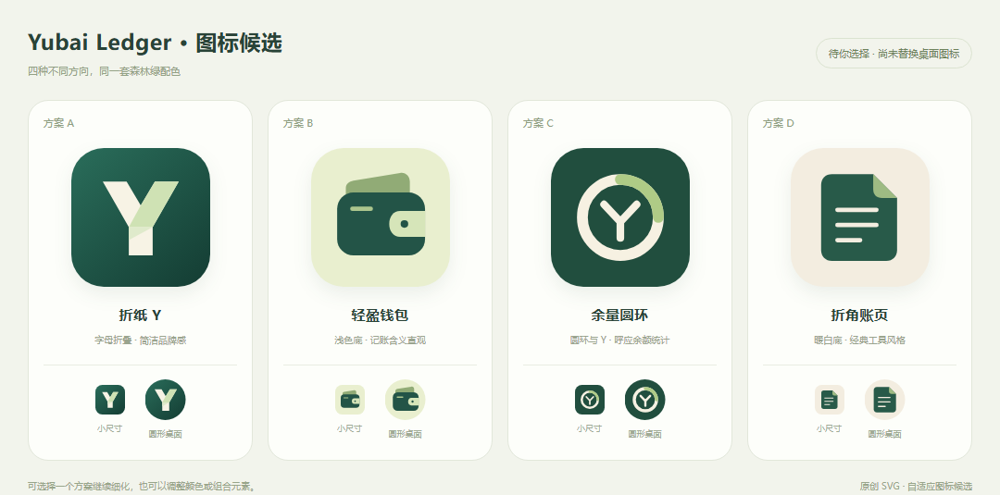

# 桌面图标候选

状态：用户已选择 **B「轻盈钱包」**，从 1.0.3 起用于应用桌面图标和 README 标识；安装后的显示名称为“余白”。其余方案保留为设计记录。

| 方案 | 名称 | 方向 |
|---|---|---|
| A | 折纸 Y | 深绿底、折叠字母，偏简洁品牌标识 |
| B | 轻盈钱包 | 浅绿底、钱包造型，记账含义直观 |
| C | 余量圆环 | 圆环与 Y，呼应余额与统计 |
| D | 折角账页 | 暖白底、折角账单，偏经典工具风格 |

预览同时包含大图、小尺寸和圆形裁切。B 方案已制作 Android 自适应前景、背景和 Android 13+ 单色主题层；主体位于安全区域内。适配依据见 [Android 官方图标指南](https://developer.android.com/develop/ui/compose/system/icon_design_adaptive)。

[查看打包资源渲染与桌面名称预览](../screenshots/icon-b-preview.png)。

这些图标为项目原创 SVG；用户提供的其他软件截图仅用于导航布局参考，未复制或上传其图像资产。
